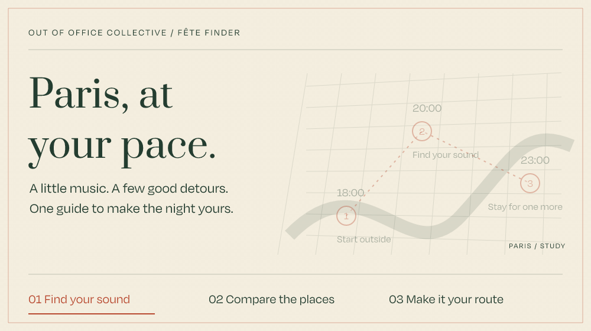
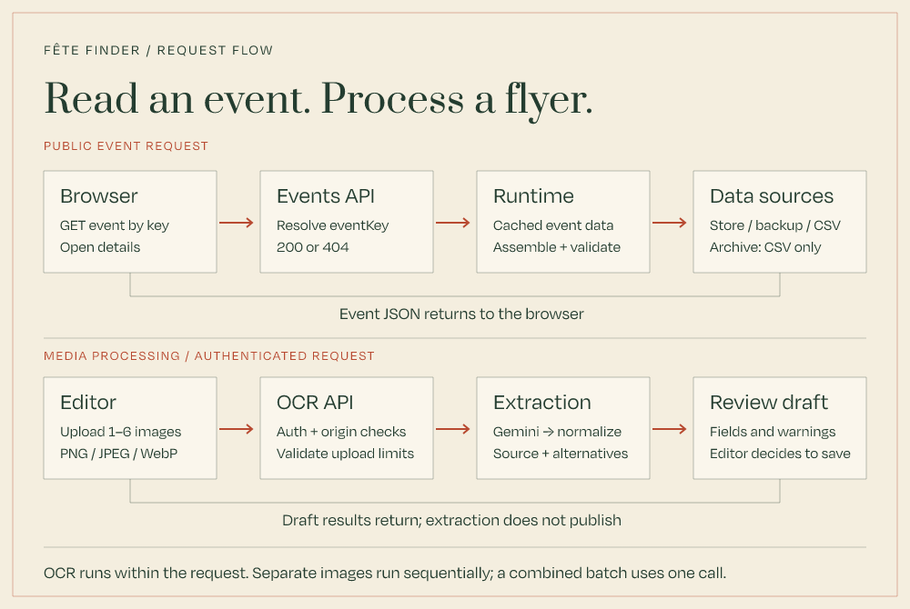

# Fête Finder

A Paris music guide by **Out Of Office Collective**. Find your sound, save a few favourites, and turn a city full of possibilities into your own route through Fête de la Musique.



*An illustrative journey, not a live itinerary. [View the still artwork](docs/assets/finder-route.png).*

## A weekend scattered across the internet

The listings were everywhere: flyers, Instagram posts, ticketing pages, and group chats. The useful details—when, where, how much, and what kind of music—rarely arrived in the same format.

Fête Finder brings them into one guide. Browse by date, genre, price, and area; compare places on a map; open an event, save it, add it to a calendar, or build a route with friends. OOOC Picks give the guide a point of view alongside the wider listings.

## From a flyer to a night out

| Behind the guide | In the guide |
| --- | --- |
| Collect candidate listings and flyer images | Search a consistent event catalogue |
| Extract draft fields with Gemini, retaining evidence and uncertainty | Compare dates, prices, genres, and settings |
| Review missing details, conflicting suggestions, and possible duplicates | Open a stable event link or find a place on the map |
| Publish reviewed rows through the admin sheet | Save favourites and arrange stops into a route |

The AI-assisted intake proposes data. The editor decides what is ready to publish. Collection agents and page-watching tools sit outside this app; the built-in OCR editor also accepts manually uploaded images. [Follow the data journey →](docs/architecture/event-intake.md)

## Built for the day itself

- **Useful on a phone.** Filters, event details, maps, calendar links, and routes support decisions while moving around the city.
- **Links that survive edits.** An immutable event key identifies a listing; its title and URL slug can change.
- **A guide that can recover.** Live reads fall back from Postgres to a database backup, then the bundled CSV. Saved browser snapshots support browsing after a successful online visit; maps still need connectivity.
- **A season with an ending.** Archive mode preserves a frozen guide with local routes and no account or database writes. It is separate from the lightweight off-season holding page used by the checked-in Dockerfile.

[Product goals](docs/product/goals.md) · [Architecture](docs/architecture/overview.md)

## Try the guide locally

Use the Node version declared in `package.json` and pnpm. A database and provider keys are unnecessary for browsing the bundled archive.

```sh
pnpm install
cp .env.example .env.local
```

In `.env.local`, set `DATA_MODE=local`, both `ARCHIVE_MODE` and `NEXT_PUBLIC_ARCHIVE_MODE` to `true`, and `NEXT_PUBLIC_ANALYTICS_ENABLED=false`. Leave `DATABASE_URL` and `ADMIN_KEY` empty. Replace the example `AUTH_SECRET` with a locally generated value of at least 32 characters, kept only in that ignored file.

```sh
pnpm dev
```

Open [localhost:3000](http://localhost:3000). This runs the Next.js guide; the root Dockerfile currently builds the off-season holding page instead. For authenticated editing and live integrations, use a development Postgres database and the [local data workflow](docs/operations/local-data-workflow.md). See the [environment reference](docs/reference/environment-variables.md) for optional providers.

## Inside the repo



[Still diagram](docs/assets/system-map.png) · [Architecture details](docs/architecture/overview.md)

Next.js App Router, React, TypeScript, Tailwind, Postgres, and MapLibre. Vitest and Playwright cover domain logic and browser journeys; Biome checks code style.

| Area | Responsibility |
| --- | --- |
| `app/` | Public pages, admin surfaces, and HTTP boundaries |
| `features/events/` | Discovery, filtering, details, placements, and engagement |
| `features/plans/` | Route planning, local persistence, and shared plans |
| `features/data-management/` | Event assembly, OCR drafts, sheet editing, and publishing |
| `features/locations/`, `features/maps/` | Venue resolution, coordinates, and map experience |
| `lib/platform/` | Postgres repositories, storage adapters, and logging |
| `docs/` | Product intent, system contracts, runbooks, and references |

Start with the [docs map](docs/README.md). Operational detail lives there so this page can stay about the guide.

## Rights

Source-available; all rights reserved. The repository is shared for inspection and is **not licensed for reuse**. Code and OOOC brand assets remain subject to [LICENSE](LICENSE).
