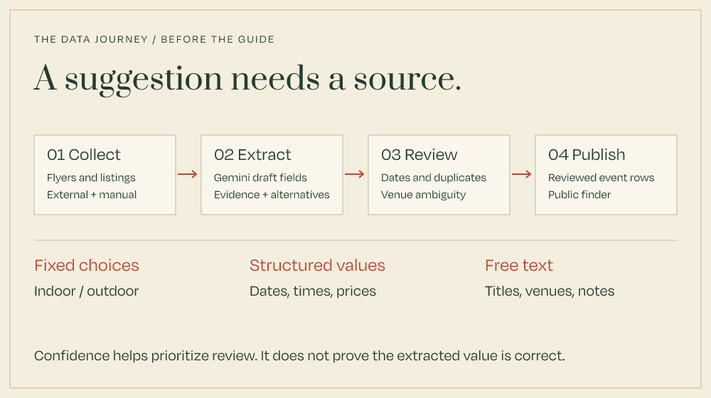

# From source material to reviewed events

The difficult input is a flyer or social post that combines artwork, venue shorthand, dates, ticket links, and incomplete details. Fête Finder's OCR workflow converts that material into a reviewable event-sheet draft.

## Collection and extraction are different jobs

Source material can come from ticketing listings, social posts, or manually uploaded flyers. Collection and page monitoring are external to the application's OCR workflow.

The app's verified boundary begins with images submitted to the authenticated event-sheet OCR workflow. `GeminiEventOcrExtractor` calls Gemini, requests JSON, and supplies the event field names. Its default model is `gemini-2.5-flash-lite`, configurable through environment settings.

## Fixed fields, mixed kinds of values

A fixed schema determines **which columns exist**. It does not mean every value comes from a fixed list.

| Kind | Example | What constrains it |
| --- | --- | --- |
| Fixed choices | `setting`: Indoor, Outdoor, Indoor/Outdoor | Prompt guidance and sheet normalization |
| Structured values | Dates, times, age guidance, price | Formatting and domain interpretation; price and age can arrive as strings |
| Free text | Event title, location, notes | Source evidence and editor review |

For example, a flyer can supply the free-text title “Example rooftop session” and the fixed choice “Outdoor”. A date can be normalized to an ISO date, while “€15–€20” needs price interpretation. These are illustrative values, not a real listing.

OCR candidates are represented as strings or null, then normalized into the row. Age guidance and prices are not strict OCR enums.

## Keep uncertainty attached

Every proposed field can carry its value, quoted evidence, confidence, source-image identifiers and filenames, and up to three alternatives. The prompt asks for null when evidence is absent and warnings for conflicting sources. Model confidence is self-reported, not a calibrated probability.

The normalizer clamps confidence to 0–1, tolerates malformed fields, and builds an editable row. It marks the row as a draft, leaves source confirmation unset, and reports missing title or date. That gives the editor something to inspect rather than silently inventing a complete listing.

Multiple images may describe one event. The extraction prompt asks the model to merge complementary details and surface genuine conflicts. The editor also supports treating uploads as separate events; a batch is not automatically proof of one event.

## Review the failure cases

| Failure | Review signal | Human decision |
| --- | --- | --- |
| Missing date | OCR draft reports missing required title/date | Find a supported date or keep the row incomplete |
| Conflicting values | Evidence, alternatives, and warnings remain on the draft | Choose the supported value or correct it |
| Duplicate listing | Schema checks flag repeated event keys; separate sources may still describe the same event | Decide whether two sources describe one event or distinct dates/editions |
| Incorrect venue | Separate Google geocoding and location-resolution workflow | Confirm the actual venue before accepting a coordinate |
| Invalid model response | JSON parsing failure, HTTP error, or timeout fails extraction | Retry or enter the row manually |

A stable `eventKey` protects identity after publication; it does not solve fuzzy entity matching by itself. Likewise, a successful Google lookup is not proof that the extracted venue was correct.

## Source map

- [Draft fields and provenance](../../features/data-management/event-ocr/types.ts)
- [Gemini prompt, response parsing, and timeout](../../features/data-management/event-ocr/gemini-extractor.ts)
- [Normalization and missing-field reporting](../../features/data-management/event-ocr/normalizer.ts)
- [CSV schema checks](../../features/data-management/validation/csv-schema-report.ts)
- [Event identity](event-identity.md)
- [Location resolution](../integrations/geocoding.md)

The collection orchestrator is outside this repository. The documented app boundary is image input, reviewable draft output, and editor-controlled publication.
