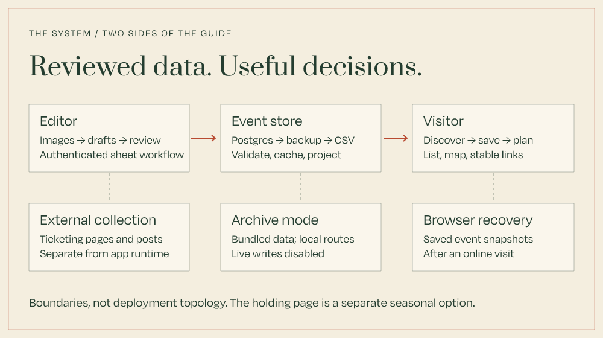
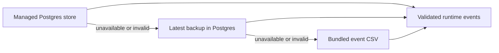

# Architecture

Fête Finder has two main actors: a visitor choosing where to go, and an editor maintaining the guide. Collection helpers prepare source material outside the app. The application's job is to turn reviewed event rows into a dependable public experience.

## Follow one listing

1. An editor imports rows or uploads flyer images into the event sheet. Gemini returns draft fields with evidence, confidence, alternatives, and warnings.
2. The editor reviews and saves the sheet. Event identity is kept separate from editable titles and venues.
3. `getLiveEvents()` assembles runtime events through `DataManager`, then applies placement and engagement projections where enabled.
4. Public pages deliver the event data. Client islands handle search, filters, maps, details, and account-dependent controls.
5. The browser can persist validated event snapshots for a later offline visit. Local route state is a separate concern from shared, server-backed plans.

[The intake contract](event-intake.md) explains the boundary between model suggestions and published data.

## Boundaries that matter

| Boundary | Responsibility | Owning source |
| --- | --- | --- |
| Source → draft | Extract and normalize suggestions, retain uncertainty | `features/data-management/event-ocr/` |
| Sheet → stored event | Validate rows and preserve event keys | `features/data-management/csv/`, `features/data-management/validation/` |
| Store → public event | Read, cache, and apply projections | `features/data-management/runtime-service.ts`, `data-manager.ts` |
| Event → interaction | Filter, order, save, open details, track actions | `features/events/` |
| Place → coordinate | Resolve venues independently of OCR | `features/locations/`, `features/maps/` |
| Visitor → plan | Persist local routes and coordinate live sharing | `features/plans/` |
| Request → privileged action | Validate sessions and rate-limit writes | `app/api/`, `features/security/` |

## Reads and recovery

In `DATA_MODE=remote`, the source chain is:

The backup is stored in Postgres too: it helps with damaged live event data, but it is not an independent database-outage fallback. The bundled CSV supplies that final fallback and may be stale. Runtime results retain their source and error context.

`DATA_MODE=local` reads only the bundled CSV; `test` uses fixtures. Archive mode forces local reads outside test mode and disables live account and write workflows. [Archive operations](../operations/archive-mode.md) describe its flags and support snapshots.

## Rendering and browser state

Next.js owns route rendering and server data access. Cache policy belongs to each route and to the runtime data cache; a single “static-first” label does not describe every page. The live finder and planner use dynamic routes while event data can be cached separately. Admin save and revalidation flows invalidate public data.

The event client is an orchestration shell around smaller list, filter, summary, map, modal, and auth islands. Maps load independently so a failed map does not make the list unusable.

For offline recovery, the service worker caches approved public shells and assets; IndexedDB stores validated event snapshots. It excludes auth, admin, user, cron, webhook, and other sensitive surfaces. A first successful online visit is required. Coordinates in an archive do not make map tiles available offline. [Offline access](offline-access-goals.md) records the implementation and limits.

## Auth, writes, and integrations

Public account state is distinct from server-validated admin authentication. `/admin` groups work into content, placements, operations, and insights. Hiding a client control is not authorization: privileged actions must validate the server session.

Postgres holds event rows, scheduling, engagement aggregates, settings, submissions, and other live state. User-facing actions cross explicit HTTP or server-action boundaries with abuse controls. Provider keys stay server-side.

Gemini assists draft extraction. Google geocoding resolves venue coordinates. Stripe webhook intake and ticket-exchange bot endpoints serve specific operational workflows; they are not the social collection orchestrator. The separate `fete-bot` project manages WhatsApp community workflows and connects to the ticket exchange.

## Seasonal deployment

The Next.js app supports both live and archive behavior. The checked-in root Dockerfile on this documentation branch serves `railway-placeholder/` with Caddy, a separate lightweight off-season holding page. Running `pnpm dev` starts the full application. A Docker deployment and a local app demo therefore do not necessarily show the same experience.

Confirm the build configuration and running service before making deployment claims; repository support for a mode does not establish that it is deployed.

## Read further

[Identity](event-identity.md) · [Intake](event-intake.md) · [Engagement](engagement-tracking.md) · [Locations](../integrations/geocoding.md) · [Admin operations](../operations/admin-workflow.md) · [Rate limiting](../security/rate-limiting.md)
